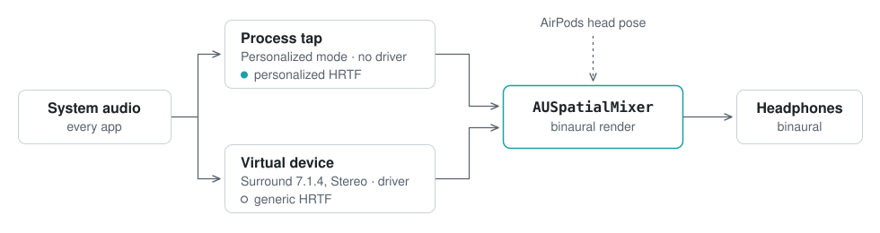

# atmos-control

A macOS menu-bar app that plays all system audio through Apple's spatial audio renderer, with
your personalized HRTF and AirPods head tracking, and exposes the renderer settings macOS hides.

macOS gives you one Spatial Audio switch per device. atmos-control runs Apple's `AUSpatialMixer`
itself, feeds it everything your Mac plays, and sends the binaural result to your headphones. You
choose how the source is laid out and where it sits (azimuth, elevation, distance, width), plus
the output type, spatialization algorithm, HRTF mode, room reverb and head tracking. Audio is
processed on your Mac; the app makes no network connections.

It renders stereo and 7.1.4 audio binaurally. It does not decode Dolby Atmos.

<p align="center">
  
</p>

## Requirements

- Apple Silicon Mac with macOS 26 (Tahoe) or newer.
- Headphones. Personalized HRTF needs AirPods with a Personalized Spatial Audio profile (scanned
  on an iPhone); head tracking needs AirPods that support it. Other headphones get Apple's generic
  HRTF.

## Install

1. Download `atmos-control-<version>-macos-arm64.zip` from
   [Releases](https://github.com/yukij3/atmos-control/releases), unzip it and move
   `atmos-control.app` to `/Applications`.
2. Open it. The app is self-signed and not notarized, so macOS blocks the first launch. Go to
   System Settings ▸ Privacy & Security, click "Open Anyway" next to the atmos-control message
   and confirm. (Right-click ▸ Open no longer skips this on macOS 15 and later.) Or clear the
   quarantine flag instead:

   ```bash
   xattr -dr com.apple.quarantine /Applications/atmos-control.app
   ```

3. The app lives in the menu bar and has no Dock icon. The first time you turn it on, macOS asks
   for permission to capture audio. Allow it.
4. Turn off Spatial Audio for your AirPods in Control Center ▸ Sound. Otherwise the audio is
   spatialized twice.

### Optional: the loopback driver

You only need the driver for the Surround 7.1.4 and Stereo modes. Download
`atmos-control-driver-<version>.zip` from the same release, unzip it, and run:

```bash
cd ~/Downloads/atmos-control-driver-<version>
bash install-driver.sh --dry-run   # print the commands it will run
bash install-driver.sh             # asks for confirmation and your admin password
```

The script copies `atmos-control.driver` to `/Library/Audio/Plug-Ins/HAL` and restarts
`coreaudiod`, so audio drops out for about a second. An output device named "atmos-control"
should then appear in System Settings ▸ Sound.

The driver has only been tested with System Integrity Protection disabled. Whether it loads with
SIP on has not been verified yet. Don't disable SIP for it; if the device doesn't appear, open an
issue with your macOS version.

## Using it

<picture>
  <source media="(prefers-color-scheme: dark)" srcset="docs/assets/signal-path-dark.svg">
  
</picture>

| Mode | Driver | HRTF | Use it for |
|---|---|---|---|
| Personalized (default) | no | personalized when available, otherwise generic | everyday listening on headphones |
| Surround 7.1.4 | yes | generic | 12-channel audio from Apple Music; each channel is placed at its speaker position |
| Stereo | yes | generic | any output device |

- Personalized HRTF engages only in Personalized mode, with AirPods that have a profile, output
  type set to headphones and the automatic algorithm. The app shows whether Apple's renderer
  reports your profile in use. If it doesn't, you still get binaural sound with the generic HRTF.
- With AirPods, head tracking keeps the soundstage fixed in the room while you turn your head.
- Apple Music's Dolby Atmos setting (Music ▸ Settings ▸ Playback): set it to Off for Personalized
  and Stereo, and to Automatic for Surround 7.1.4 so Music sends real multichannel audio.
- Surround 7.1.4 and Stereo switch the system output to the atmos-control device while they run
  and switch it back when you turn the engine off or quit.

<p align="center">
  
</p>

## Troubleshooting

- No sound after atmos-control crashed or was force-quit in Surround or Stereo mode: the system
  output is still set to "atmos-control". Pick your headphones or speakers again in Control
  Center ▸ Sound.
- Surround 7.1.4 and Stereo can't be selected: the driver isn't installed or didn't load. Check
  with `system_profiler SPAudioDataType | grep -i atmos`, and see the SIP note above.
- The engine won't start and asks for permission: audio capture was denied earlier. Allow
  atmos-control in System Settings ▸ Privacy & Security, then turn it on again.
- Sound seems spatialized twice: system Spatial Audio is still on for your AirPods. Turn it off in
  Control Center ▸ Sound.

## Uninstall

Quit atmos-control and delete `/Applications/atmos-control.app`. To remove the driver:

```bash
sudo rm -rf /Library/Audio/Plug-Ins/HAL/atmos-control.driver
sudo launchctl kickstart -k system/com.apple.audio.coreaudiod
```

From a source checkout, `./uninstall.sh --with-driver` does both. atmos-control installs no
LaunchAgents, daemons or login items.

## Build from source

You need the Xcode Command Line Tools (`xcode-select --install`) and a Rust toolchain
([rustup](https://rustup.rs)).

```bash
git clone https://github.com/yukij3/atmos-control.git
cd atmos-control
App/build-app.sh                # builds dist/atmos-control.app
./install.sh --with-driver      # builds, copies the app to /Applications, installs the driver
```

`./install.sh` without `--with-driver` installs only the app. Background notes are in
[`docs/PLAN.md`](docs/PLAN.md) and [`docs/PHASE0-RESULTS.md`](docs/PHASE0-RESULTS.md).

## License

[MIT](LICENSE)
